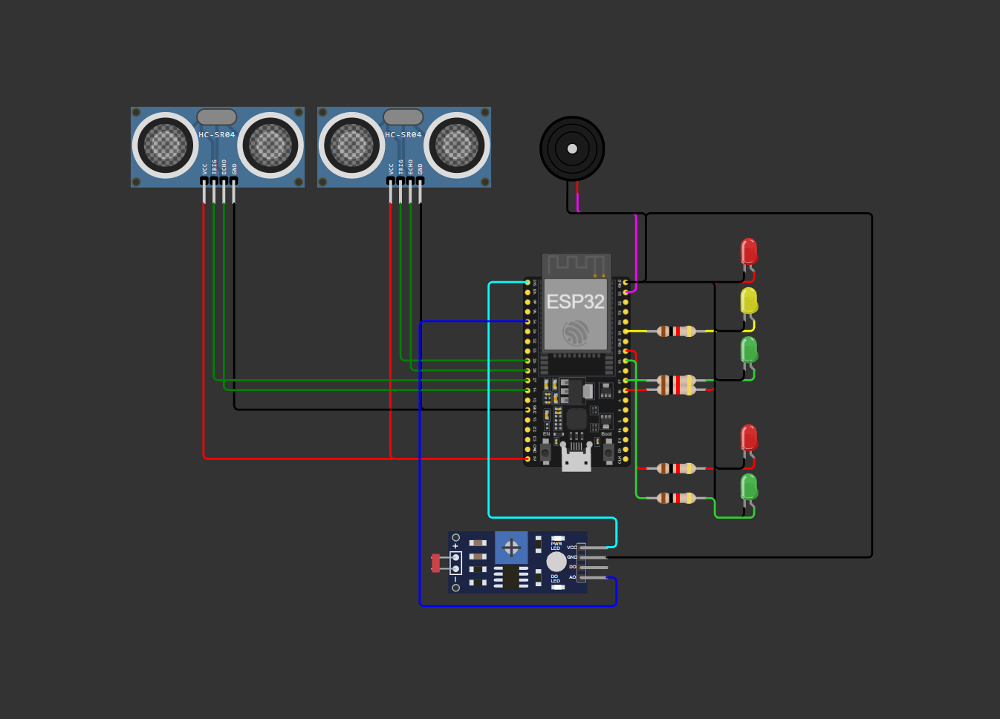

# 🚦 Passaí

### ⚙️ Semáforo Inteligente para Travessias Urbanas Acessíveis

---

# 📖 Sobre o Projeto

Imagine uma pessoa idosa tentando atravessar uma avenida movimentada, mas o tempo disponível no semáforo não é suficiente para que ela chegue ao outro lado com segurança.

Essa é uma dificuldade enfrentada por pessoas com mobilidade reduzida, idosos e outros pedestres que necessitam de mais tempo para realizar uma travessia.

O **Passaí** foi desenvolvido para simular um sistema inteligente de travessia de pedestres, capaz de identificar a presença de pessoas, controlar automaticamente os semáforos e ampliar o tempo de travessia quando necessário.

Utilizando um **ESP32 e sensores ultrassônicos**, o sistema monitora a área de espera e a faixa de pedestres, toma decisões localmente e aciona sinais visuais e sonoros.

Além disso, os eventos são enviados por Wi-Fi a uma API integrada ao **Supabase**, permitindo seu armazenamento e acompanhamento por uma aplicação web.

O projeto faz parte da Global Solution 2026.2 da FIAP, dentro do desafio **CitizenTech**, com foco em mobilidade urbana e acessibilidade, especialmente no contexto da Zona Norte de São Paulo.

---

# ❗ Por que isso é importante?

A mobilidade urbana precisa considerar as diferentes capacidades e necessidades dos cidadãos.

Um tempo de travessia fixo pode representar uma dificuldade para pessoas que caminham mais lentamente ou precisam de atenção adicional.

O Passaí busca demonstrar como sensores, automação e processamento local podem contribuir para travessias mais inclusivas.

O projeto se relaciona principalmente ao:

**ODS 11 | Cidades e Comunidades Sustentáveis**

Contribuindo com a proposta de tornar os espaços urbanos mais acessíveis, seguros e inclusivos.

---

# 🖼️ Projeto Montado

### 🚦 Circuito desenvolvido no Wokwi utilizando ESP32, sensores ultrassônicos, LDR, LEDs e buzzer



---

# 🎯 Objetivo da Solução

O Passaí tem como objetivo demonstrar um sistema inteligente capaz de adaptar o tempo de travessia de pedestres com base na presença detectada por sensores.

A solução busca:

- Identificar pedestres aguardando para atravessar.
- Controlar automaticamente os semáforos de veículos e pedestres.
- Disponibilizar um tempo-base de travessia.
- Conceder tempo adicional quando a faixa permanece ocupada.
- Identificar situações de risco e falhas de sensores.
- Emitir sinais visuais e sonoros.
- Registrar eventos em uma plataforma conectada.

O protótipo também demonstra um dos principais conceitos de **Edge Computing**: tomar decisões diretamente no dispositivo, sem depender da conexão com a internet para controlar o semáforo.

---

# 🧠 Como o Sistema Funciona?

O sistema trabalha em cinco etapas principais.

## 🥇 1. Monitoramento dos Pedestres

Dois sensores ultrassônicos HC-SR04 monitoram regiões diferentes:

- **Área de espera:** identifica a presença de pessoas aguardando a travessia.
- **Faixa de pedestres:** verifica se a região de travessia permanece ocupada.

O ESP32 realiza leituras periódicas, suaviza os valores recebidos e utiliza confirmações sucessivas para reduzir acionamentos indevidos.

## 🥈 2. Processamento Inteligente

O ESP32 interpreta as informações dos sensores e controla os estados do semáforo.

O sistema utiliza uma distância experimental inferior a **80 cm** para identificar presença.

Quando um pedestre é detectado na área de espera e a faixa está livre, o dispositivo inicia a sequência de travessia.

Todo esse processamento acontece localmente.

## 🥉 3. Preparação da Travessia

Após detectar um pedestre:

1. O semáforo dos veículos muda de verde para amarelo.
2. O sinal amarelo permanece durante 2,5 segundos.
3. Os dois semáforos permanecem vermelhos por 1,5 segundo.
4. O semáforo dos pedestres é liberado.

Essa transição evita a liberação imediata da faixa e estabelece um intervalo de segurança.

## 🏅 4. Travessia Adaptativa

A travessia possui um tempo-base de **10 segundos**.

Ao final desse período, o ESP32 verifica o sensor instalado na faixa.

Caso a região ainda esteja ocupada, o sistema concede automaticamente uma extensão de **4 segundos**, uma única vez por ciclo.

O tempo total pode chegar a **14 segundos**.

Se a faixa permanecer ocupada após esse limite, o sistema entra em estado de alerta, mantendo os veículos parados.

## 🏁 5. Finalização e Monitoramento

Quando a travessia termina com a faixa livre, o sistema realiza uma etapa de finalização com os dois sinais vermelhos e retorna à circulação normal de veículos.

Os eventos de travessia, extensão, finalização e alerta são enviados para uma Edge Function do Supabase.

Cada travessia recebe um identificador `ciclo_id`, permitindo relacionar os eventos de um mesmo ciclo.

Caso a conexão falhe, o controle local continua funcionando. O protótipo também possui uma fila temporária em memória e tentativas de reenvio dos eventos.

---

# 🔍 Entendendo os Componentes

## 🔌 ESP32

É o cérebro do Passaí.

Responsável por:

- Ler os sensores.
- Processar as distâncias detectadas.
- Executar a máquina de estados.
- Controlar os semáforos.
- Acionar o buzzer.
- Identificar situações de alerta.
- Enviar eventos via Wi-Fi.

## 📡 Sensor Ultrassônico da Área de Espera

Identifica se existe uma pessoa aguardando para atravessar.

Quando a presença é confirmada, o sistema solicita um novo ciclo de travessia.

Após uma solicitação, o sensor precisa identificar a área livre antes de permitir um novo acionamento, evitando ciclos repetidos para a mesma presença contínua.

## 🚶 Sensor Ultrassônico da Faixa

Monitora a região onde ocorre a travessia.

É utilizado para:

- Verificar se a faixa está ocupada.
- Determinar a necessidade de tempo adicional.
- Identificar permanência após o limite de tempo.
- Permitir o retorno seguro à circulação de veículos.

## ☀️ Sensor de Luminosidade LDR

Realiza a leitura da luminosidade ambiente e disponibiliza o valor no monitor serial.

No protótipo atual, a luminosidade é monitorada, mas não modifica automaticamente o tempo de travessia.

## 🚦 LEDs dos Semáforos

O sistema utiliza cinco LEDs:

| Semáforo | Cor | Função |
|---|---|---|
| Veículos | 🟢 Verde | Circulação permitida |
| Veículos | 🟡 Amarelo | Transição de segurança |
| Veículos | 🔴 Vermelho | Veículos parados |
| Pedestres | 🔴 Vermelho | Travessia não liberada |
| Pedestres | 🟢 Verde | Travessia permitida |

## 🔊 Buzzer

Emite sinais sonoros durante a liberação da travessia e em situações de alerta.

O componente complementa a sinalização visual do protótipo.

---

# ⚙️ Componentes Utilizados

| Componente | Função |
|---|---|
| 🔌 ESP32 | Processamento e controle |
| 📡 2 sensores HC-SR04 | Detecção de presença |
| ☀️ Sensor LDR | Monitoramento de luminosidade |
| 🚦 5 LEDs | Sinalização de veículos e pedestres |
| 🔊 Buzzer | Avisos sonoros |
| 🔗 Resistores de 220 Ω | Limitação de corrente dos LEDs |
| 🔗 Fios | Conexões do circuito |

---

# 🔌 Estrutura do Circuito

| Componente | Pino no ESP32 |
|---|---|
| Sensor de espera - TRIG | GPIO 25 |
| Sensor de espera - ECHO | GPIO 26 |
| Sensor da faixa - TRIG | GPIO 27 |
| Sensor da faixa - ECHO | GPIO 14 |
| Sensor LDR - AO | GPIO 34 |
| LED vermelho dos veículos | GPIO 16 |
| LED amarelo dos veículos | GPIO 21 |
| LED verde dos veículos | GPIO 17 |
| LED vermelho dos pedestres | GPIO 19 |
| LED verde dos pedestres | GPIO 18 |
| Buzzer | GPIO 23 |

Os componentes também utilizam as conexões de alimentação e GND correspondentes.

---

# 🚨 Funcionamento do Sistema

## 🚦 Estados do Semáforo

| Estado | Comportamento |
|---|---|
| VEICULOS | Veículos liberados e pedestres aguardando |
| AMARELO | Preparação para interromper o tráfego |
| PREPARACAO | Ambos os sinais vermelhos |
| TRAVESSIA | Pedestres liberados |
| FINALIZACAO | Intervalo de segurança após a travessia |
| ALERTA | Condição de risco com veículos bloqueados |

## ⏱️ Tempo de Travessia

| Situação | Ação |
|---|---|
| Nenhum pedestre detectado | Mantém circulação de veículos |
| Pedestre aguardando | Inicia sequência de travessia |
| Faixa livre após 10 segundos | Finaliza normalmente |
| Faixa ocupada após 10 segundos | Adiciona 4 segundos |
| Faixa ocupada após 14 segundos | Entra em ALERTA |
| Faixa liberada durante alerta | Aguarda recuperação e retorna ao funcionamento normal |
| Sensor inválido em condição crítica | Mantém ou aciona o estado de segurança |

## 📡 Comunicação com o Supabase

O ESP32 utiliza a rede virtual `Wokwi-GUEST` para enviar eventos em formato JSON a uma Supabase Edge Function.

Os eventos incluem informações como:

- Identificação do dispositivo.
- Identificação do ciclo.
- Estado do semáforo.
- Presença detectada.
- Tempo-base.
- Extensão aplicada.
- Validade dos sensores.
- Indicação de falha.

O banco de dados armazena esses registros na tabela `eventos_iot`, possibilitando sua utilização no dashboard web do Passaí.

A comunicação utiliza autenticação específica para o dispositivo. Credenciais privadas não devem ser publicadas no código-fonte.

---

# 🧠 Exemplo da Lógica Utilizada

O sistema utiliza condições para verificar se o pedestre precisa de tempo adicional:

```cpp
if (
  decorrido >= TEMPO_BASE &&
  extensao == 0 &&
  !faixaLivre()
) {
  extensao = TEMPO_EXTRA;

  Serial.println("EXTENSAO: +4 segundos");

  registrarEventoIoT(
    "TRAVESSIA",
    faixaOcupada(),
    !faixa.valido
  );
}
```

O ESP32 também utiliza `millis()` para controlar a duração dos estados sem interromper continuamente a execução do sistema.

As leituras são suavizadas e verificadas antes das decisões.

Em situações de risco, o semáforo adota um comportamento conservador, mantendo os veículos parados enquanto a condição não é resolvida.

---

# 💻 Código Fonte

O código-fonte do Passaí foi desenvolvido em C++ para ESP32 utilizando o simulador Wokwi.

A implementação contém:

- Configuração dos componentes.
- Leitura e suavização dos sensores.
- Máquina de estados.
- Controle dos LEDs.
- Sinalização sonora.
- Gerenciamento dos tempos.
- Tratamento de leituras inválidas.
- Comunicação Wi-Fi e HTTPS.
- Geração de identificadores de ciclos.
- Registro e envio de eventos IoT.

O código completo pode ser visualizado na simulação compartilhada do Wokwi.

---

# ▶️ Instruções de Execução

Para executar o projeto:

1. Acesse o link público da simulação no Wokwi.
2. Clique em **Start Simulation**.
3. Aguarde a inicialização do ESP32.
4. Ajuste o sensor da área de espera para aproximadamente **50 cm**.
5. Mantenha o sensor da faixa acima de **80 cm**.
6. Observe a sequência dos semáforos até a liberação dos pedestres.
7. Durante a travessia, ajuste o sensor da faixa para aproximadamente **40 cm**.
8. Observe a extensão automática de 4 segundos.
9. Libere a faixa antes do final para concluir normalmente ou mantenha a ocupação para demonstrar o alerta.
10. Acompanhe as mudanças de estado pelo monitor serial.

O funcionamento local do circuito não depende de conexão com o Supabase.

---

# 🛠️ Tecnologias Utilizadas

- **ESP32:** microcontrolador responsável pelas decisões locais.
- **C++ / Arduino:** programação do sistema embarcado.
- **Wokwi:** simulação do circuito eletrônico.
- **Sensores HC-SR04:** medição de distâncias.
- **LDR:** leitura analógica de luminosidade.
- **Wi-Fi e HTTPS:** comunicação de eventos.
- **Supabase:** backend, Edge Function e banco de dados.
- **Edge Computing:** processamento e tomada de decisão no dispositivo.

---

# 🔗 Acesse o Projeto

## 👉 Simulação no Wokwi

**[]**

## 👉 Vídeo Explicativo

**[]**

---

# 👨‍💻 Equipe de Desenvolvimento

| Integrante | RM |
|---|---|
| Beatriz de Araujo Périgo | 569654 |
| Fabricio Denig de Avila | 570980 |
| Rafael Taboada Sobral | 569527 |

---

# 🏫 Contexto Acadêmico

Projeto desenvolvido para a **Global Solution 2026.2**, da disciplina **Edge Computing & Computer Systems**, do curso de Engenharia de Software da FIAP.

O Passaí integra o desafio **CitizenTech**, demonstrando como tecnologias de Internet das Coisas, sensores e computação de borda podem ser aplicadas à mobilidade urbana acessível.

A solução apresenta um protótipo experimental de semáforo inteligente capaz de detectar pedestres, adaptar o tempo de travessia, responder a situações de risco e registrar eventos para acompanhamento em uma plataforma web.

---

# 🚦 Obrigado por visitar o Passaí!

### Uma cidade melhor começa na travessia.
